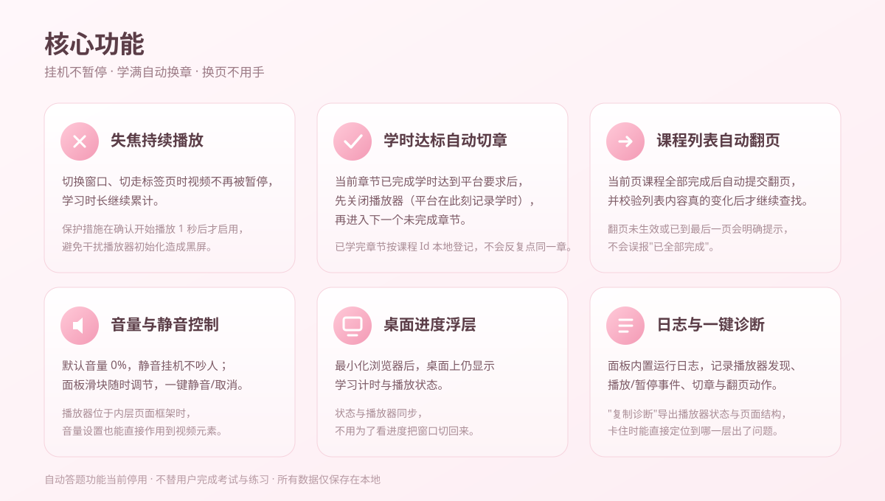
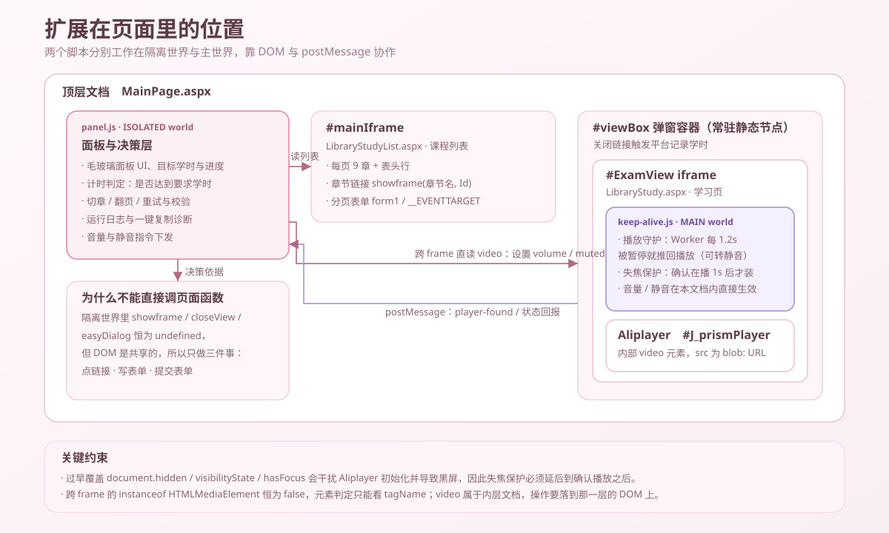
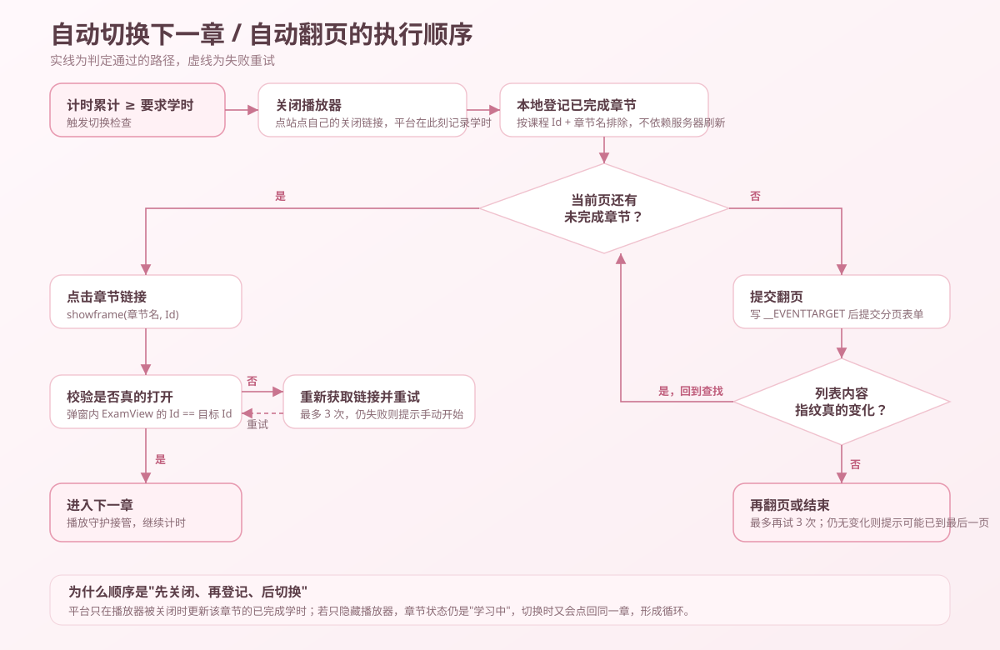

# 奶猪水课助手 · Milk Pig Study Buddy


> 让网课"挂着也能学完"的浏览器扩展：失焦不断播、学时达标自动切下一章、课程列表自动翻页。

**v2.3.46** · Manifest V3 · Edge / Chrome / 其他 Chromium 内核浏览器 · [MIT 许可](LICENSE)

- 不需要装任何运行环境，解压文件夹拖进浏览器即可
- 全部逻辑在本地运行，无服务端、不上传任何数据
- 不破解付费内容、不绕过考试与身份核验，也不做任何"规避检测"的承诺

---

## 它能做什么



| 功能 | 说明 |
| --- | --- |
| 失焦持续播放 | 切换窗口、切走标签页时视频不再被暂停，时长继续累计 |
| 学时达标自动切章 | 达到平台要求学时后，先关闭播放器（平台在此刻记录学时），再进入下一个未完成章节 |
| 课程列表自动翻页 | 当前页全部完成后自动翻页，并校验列表内容真的变化后才继续查找 |
| 目标学时控制 | 读取章节要求学时并显示实时进度，也可手动修改 |
| 音量与静音 | 默认 0% 静音挂机，面板滑块随时调节，跨页面框架也能直接作用到视频元素 |
| 桌面进度浮层 | 最小化浏览器后在桌面显示计时与播放状态 |
| 手动开始学习 | 点击后有 5 秒倒计时再执行，方便你先切好窗口 |
| 日志与一键诊断 | 记录播放器发现、播放/暂停、切章与翻页动作，可一键复制诊断结果 |
| 自定义播放器选择器 | 页面结构不同时，可手填播放器元素选择器适配 |

自动答题功能当前处于**停用**状态：界面里会提示"正在调试中"，相关接口默认不启用、不请求任何外部地址。课后练习和考试需要你本人完成，扩展不会替你点击任何答题按钮。

## 安装

1. 到 [Releases](https://github.com/hanhanha-114514/naizhu-course-helper/releases) 下载最新压缩包，解压后得到一个内含 `manifest.json` 的文件夹（请勿删除该清单文件）。
2. 地址栏打开 `edge://extensions`（Chrome 为 `chrome://extensions`），打开右上角**开发者模式**。
3. 把文件夹拖进扩展管理页，或点"加载解压缩的扩展"并选中它。
4. 打开课程页面，右侧出现粉色面板。

更新版本时，点击扩展卡片上的"重新加载"图标即可，本地设置不会丢失。

## 它是怎么工作的

扩展由两个脚本配合完成工作：面板脚本运行在隔离世界（负责决策与展示），播放守护脚本运行在页面主世界（负责视频与失焦保护）。



自动切章最容易踩的坑是"学时只在播放器被关闭后才由平台记录"。如果只把播放器隐藏掉，章节状态仍是"学习中"，切换时又会点回同一章，形成循环。因此执行顺序必须是先关闭、再登记、后切换：



几个实现细节（也是踩过的坑）：

- **失焦保护要延后启用。** 过早覆盖 `document.hidden` / `visibilityState` / `hasFocus` 会干扰播放器初始化并导致黑屏，因此保护措施在确认开始播放 1 秒后才安装。
- **播放守护不依赖首次播放成功。** 新章节的媒体信息可能 20 秒以上才就绪，早期版本"重试 10 次（约 6 秒）"就放弃，导致卡在暂停界面；现在只要视频存在就持续检查，被暂停就推回播放，有声播放被浏览器自动播放策略拒绝时回退为静音播放。
- **翻页要提交平台自己的分页表单。** 隔离世界里点击 `javascript:__doPostBack(...)` 链接不会生效，需要写入 `__EVENTTARGET` 后提交表单，并用列表内容指纹确认页码真的变了。
- **跨 frame 判定元素类型不能靠 `instanceof`。** 隔离世界里的 `instanceof HTMLMediaElement` 恒为 `false`，只能看 `tagName`。

## 目录结构

```
extension/
  manifest.json              MV3 清单（权限：storage / scripting / tabs / alarms）
  content/panel.js           面板 UI、计时、切章与翻页决策、诊断日志
  inject/keep-alive.js       主世界脚本：播放守护 + 失焦保护 + 音量静音
  background/service-worker.js  脚本注册与状态中转
  overlay/                   桌面进度浮层
  popup/                     工具栏弹窗（站点配置、本地加密的登录信息自动填充）
assets/                      文档配图
```

## 隐私与安全

- 进度、音量、日志、站点配置全部保存在 `chrome.storage.local`，扩展不含服务端，不会把账号信息发往任何第三方。
- 弹窗里的"登录信息自动填充"使用主密码保护：主密码经 PBKDF2 派生密钥、口令用 AES-GCM 加密后存本地，自动填充只在你配置的站点触发。不使用该功能则完全不涉及密码存储。
- 扩展只在课程站点内工作，不修改浏览器其他页面。

## 使用须知

- 请在本人有权学习、且所在学校或平台允许使用辅助工具的前提下使用。部分平台把学习行为用于考勤或学时认定，自动化操作可能违反其使用协议，相关后果由使用者自行承担。
- 本项目仅供学习与研究，作者不对使用它产生的任何账号、成绩或纪律后果负责。
- 平台调整页面结构后个别功能可能需要跟随更新，遇到这种情况请带上诊断日志开 issue。

## 常见问题

**视频打开是黑屏，或一直不播放？**
若面板日志显示"未找到播放器元素"，说明该页面播放器结构与默认配置不同，可在设置里填写播放器选择器。确认在播后 1 秒才启用失焦保护，因此刚打开章节时会有几秒缓冲。

**为什么没有自动切到下一章？**
学时通常要等播放器被关闭后才由平台记录。扩展会先关闭播放器再进入下一章；若当前页已全部完成，会自动翻页并校验列表变化后再继续。

**连刷好几章后卡在暂停界面？**
这是 v2.3.46 修复的问题：早期版本的自动播放重试窗口只有约 6 秒，而新章节元数据加载常需 20 秒以上，重试耗尽后再也没有恢复机制接管。现在播放守护独立运行，不再依赖首次播放成功。

**会不会影响正常做题？**
不会。答题与考试必须本人完成。

## 开发

```bash
git clone https://github.com/hanhanha-114514/naizhu-course-helper.git
# 修改 extension/ 下的代码后：
# edge://extensions → 找到"奶猪水课助手" → 点击重新加载 → 刷新课程页面
```

`inject/keep-alive.js` 运行在页面主世界，改动后必须刷新课程页面才会重新注入；`content/panel.js` 的改动同样需要刷新页面。

## 反馈问题

打开面板 → "复制诊断"，把内容贴到 issue 里。诊断包含版本号、播放器状态、各 frame 结构与最近事件，比截图更能定位问题。

## 许可

[MIT](LICENSE) © 2026 Hanhanha
